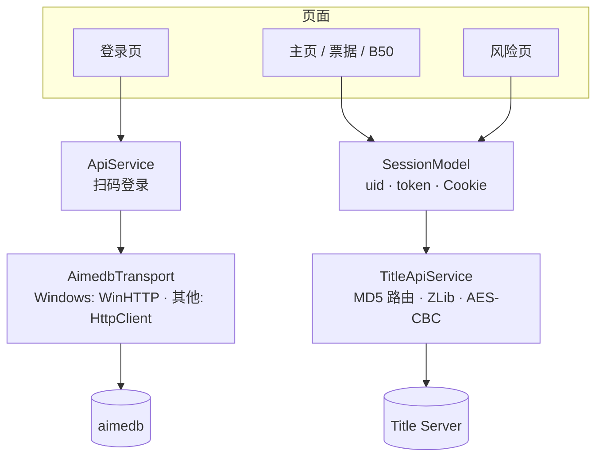

<div align="center">
  

  <h1>Ichino</h1>

  <p>基于 QR Code 登录的「某游戏」客户端 · Flutter</p>

  <p>
    
    
    
    <a href="LICENSE"></a>
    <a href="https://github.com/AirFoundation/Ichino/actions/workflows/build.yml"></a>
  </p>

  <p><code>ichino</code> · <code>dev.naominet.ichino</code> · v1.0.0</p>
</div>

[功能一览](#功能一览) · [快速开始](#快速开始) · [目录结构](#目录结构) · [架构概览](#架构概览) · [关键实现说明](#关键实现说明) · [构建环境注意事项](#构建环境注意事项) · [CI](#ci)

> [!WARNING]
> 「风险」页里的功能会向服务器发送伪造的 `UpsertUserAllApi` 数据包，属于高危操作，可能封号。请自行评估风险。

## 功能一览

| 模块 | 能力 |
| --- | --- |
| **主页** | Aime 登录（QR / 令牌）、Rating 详情、入坑信息、游玩统计、状态、账号备份 |
| **票据** | 功能票查询与使用 |
| **B50** | Best 50 成绩图，可导出 PNG（移植自 Empurple 的 `Best50ImageRenderer`） |
| **风险** | 歌曲解锁、收藏品获取、旅行伙伴发放与编组（含等级）、修改总 Rating、添加舞里程、一键跑图、万花筒专区 |
| **设置** | Title Server / 机器参数 / Keychip，支持配置导入导出 |
| **连接信息（实验性）** | 主页导出 uid + JSESSIONID + token 的 Base64 快照，登录页粘贴即可恢复会话；内容未加密，请勿外传 |
| **账号备份** | 主页只读地把服务器上的用户数据汇成一串 JSON（道具、舞里程、游玩统计、旅行伙伴、区域与万花筒进度、Rating/成绩）。<br>全程只发 `GetUser*Api`，不写任何数据；单段读失败不整体作废，失败段列在结果里 |

### 风险页

| 功能 | 说明 |
| --- | --- |
| 歌曲解锁 | 写入 itemKind 5 / 6 / 7，分别对应歌曲、Master、Re:Master |
| 收藏品获取 | itemKind 1 / 2 / 3 / 10 / 11 / 12：姓名框、称号、头像、搭档、背景板、功能票 |
| 旅行伙伴 | 发放角色、修改等级、编辑出战编组（`UserDetail.charaSlot`） |
| 修改 Rating | 只改总 Rating（0 ~ 99999），不动每首歌各自的 Rating |
| 添加舞里程 | 直接写 `UserDetail.point`，支持累加与直接设定，可为负 |
| 一键跑图 | 把区域 `distance` 推到上限，完成态交给客户端派生 |
| 万花筒 | 发现门、获取钥匙、标记通关，三者都在同一行 |

## 快速开始

### 环境要求

- Flutter **stable**（开发验证版本 3.47.8 / Dart 3.13.7；`pubspec.yaml` 要求 `sdk: ^3.12.0`）
- 各平台常规工具链：Android SDK 与 JDK 17、Xcode、Visual Studio（C++ 桌面开发）、CMake / Clang
- Windows 上构建前请先看[构建环境注意事项](#构建环境注意事项)

### 运行

```bash
git clone https://github.com/AirFoundation/Ichino.git
cd Ichino
flutter pub get
flutter run                      # 默认设备
```

提交前请保持质量门槛：

```bash
flutter analyze                  # 需保持 0 error/warning
flutter test
```

### 构建

| 平台 | 命令 | 产物 |
| --- | --- | --- |
| Android | `flutter build apk --release` | `build/app/outputs/flutter-apk/app-release.apk` |
| Windows | `flutter build windows --release` | `build/windows/x64/runner/Release/ichino.exe` |
| macOS | `flutter build macos --release` | `build/macos/Build/Products/Release/Ichino.app` |
| Linux | `flutter build linux --release` | `build/linux/x64/release/bundle/` |
| iOS | `flutter build ios --release --no-codesign` | `build/ios/iphoneos/Runner.app`（未签名） |

> [!NOTE]
> Release APK 目前使用 debug 签名（`android/app/build.gradle.kts` 的 `signingConfig`），产物可直接安装，但不是正式发布签名。

## 目录结构

```text
lib/
├── main.dart            # 入口（MyApp + MaterialApp）
├── config/              # 字符串、响应式布局、Title Server 配置
├── core/                # 宽松 JSON 解析、UTC+8 时间格式化
├── models/              # API 数据模型与 SessionModel（会话 / Cookie 的唯一持有者）
├── pages/
│   ├── home/            # 主页页签枚举与首页视图（HomeTab / HomeTabView）
│   └── ...              # 登录页与各功能页面
├── services/            # 传输层、payload 组装、乐曲元数据、导出、RA 计算、调试日志
└── widgets/
    ├── home/            # 主页头像、资料、统计、调试卡片
    ├── risk/            # 风险页共享脚手架、列表控件与编辑器
    └── ...              # 可复用视觉组件（B50 海报、卡片/提示、冷却 mixin、阶段进度卡）
tools/                   # 离线开发工具（不参与构建产物）
data/id_mapping/         # 由 tools/gen_id_mapping.dart 从机台数据包抽出的 ID 映射表
```

<details>
<summary><b>共享抽象</b>：风险页与通用组件收口</summary>

功能票 / 解锁歌曲 / 收藏品 / 旅行伙伴 / 数值修改 / 一键跑图 / 万花筒 / 高危 hub
这些页面以前各抄一份脚手架，现已收口到：

- `widgets/cooldown_mixin.dart` —`CooldownMixin`：登录后冷却倒计时（`Timer.periodic`）。
- `widgets/step_progress.dart` —`RiskStep` + `StepProgressCard`：执行阶段枚举与进度卡。
- `widgets/risk/risk_list_widgets.dart` —`RiskPendingList` / `RiskPendingRow` /
  `RiskDropdownField` / `RiskNumberField` / `RiskAddButton`：待提交列表与表单控件。
- `widgets/risk/music_risk_editors.dart` — 解锁歌曲与收藏品的输入编辑器
  （`PendingItem` / `PendingMusic`）。
- `widgets/app_card.dart` —`AppCard` / `SectionTitle` / `AutoLogoutToggle`。
- `widgets/app_notice.dart` —`AppNotice`（未登录/冷却/错误横幅）与 `context.showSnack`。
- `core/json_value.dart` —`jsonInt` / `jsonDouble` / `jsonBool` / `jsonString` /
  `jsonMap` / `jsonMapList`：服务器字段类型不稳定，统一宽松转换。
- `core/date_time_format.dart` — UTC+8 时间戳与 `yyyy-MM-dd HH:mm:ss.f` 格式化。
- `models/session_model.dart` —`SessionModel.createTitleService()` 统一构建会话服务；
  Cookie 在任意响应里轮换时经 `onCookiesChanged` 回写，页面不再拿旧快照。
- `services/title_api_service.dart` —`TitleApiService.fromHolder()` 统一构建会话，`config` getter
  供 payload builder 复用；`describeApiError()` 统一面向用户的错误文本。
- `services/user_all_payload_builder.dart` — 占位 `musicData`（`placeholderMusicData`）。
- `services/api_log.dart` —`ApiLog`：传输层日志，仅 debug 输出，release 下不落 token/cookie。

</details>

主页的六个页签由 `HomeTab` 枚举驱动，`IndexedStack` 只构建访问过的页签，
票据 / B50 / 风险 hub 不会再在启动时各自发一轮请求。 `TitleApiService.lastRawResponse`
是实例状态，`SessionModel` 把预览原文透传给主页调试卡，不会跨请求串数据。

平台差异只体现在原生侧：QR 解码由 Android 的 `MainActivity` 与 iOS 的
`SceneDelegate` 通过 `dev.naominet.ichino/qr_scanner` 这个 MethodChannel 提供，
桌面平台没有该 handler，因此从图片识别二维码仅在移动端可用。

## 架构概览



- `SessionModel` 是会话与 Cookie 的唯一持有者；Cookie 轮换经 `onCookiesChanged` 回写。
- `TitleApiService` 统一生成路由、编解码与用户可读的错误文本，页面不自己拼传输层。
- 扫码登录走独立的 `ApiService` / `AimedbTransport`，与游戏服务器的 Title Server 链路分开。

## 关键实现说明

以下内容是真机行为与客户端代码对齐后的结论，排查「上传成功但没生效」时优先看这里。

<details>
<summary><b>登录与传输</b>：aimedb 签名、TLS 指纹与 WinHTTP</summary>

- **扫码登录**：`ApiService` 对齐 Astral 的 `api/Chime.py` —— 端点与签名盐写死在代码里
  （`https://ai.sys-allnet.cn/wc_aime/api/get_data`），签名是
  `SHA-256(完整 Keychip + 本机本地时间 + 签名盐)`，请求体带 `titlekey: SDGB`，
  `qrCode` 只发 84 串的第 21 位起的 64 位载荷；请求头**不能带 Content-Type**，
  带了 aimedb 直接回 `errorID=57`。输入既可以是 84 位二维码串，也可以是
  `wq.wahlap.net/qrcode/req/….html` 二维码链接；Keychip 设置里填 11 位短值也能用，
  会按 placeId 补成完整形式（扫码登录用完整形式，游戏服务器才用短值）。
- **登录传输**：`AimedbTransport` 在 Windows 上走 WinHTTP FFI（`dart:ffi` +
  `Isolate.run`），其他平台走 Dart `HttpClient` 并手动补上服务器缺失的 GlobalSign
  中间证书。这么做是为了绕开服务器对 Dart/BoringSSL 的 TLS 指纹拦截——握手能被接受，
  但连接紧接着被服务端关掉；证书校验本身始终开启。
- **传输层**：`TitleApiService` 负责 `MD5(apiName + salt + obfuscateParam)` 生成 URL 路径、
  JSON → ZLib → AES-CBC 编解码、`Set-Cookie` 会话维持。

</details>

<details>
<summary><b>B50</b>：固定像素版面与导出分辨率</summary>

- **B50 成绩图**：底图 `assets/b50/base.png`（1762×1850）之上按固定像素坐标叠加头像、
  昵称、50 张卡片与页脚；卡片 300×100、每行 5 张，BEST35 从 y=350 起、BEST15 固定从
  y=1250 起。RA 与评级由 `RatingCalculator` 计算，曲名与定数取自 diving-fish 的
  `music_data`。导出走 `RepaintBoundary`，预览缩放不影响导出分辨率。

</details>

<details>
<summary><b>写包语义</b>：<code>isNew*List</code>、角色、舞里程与总 Rating</summary>

- **`isNew*List` 每一位都是插入/更新标志，不能一律发 '1'**：真机
  `VOExtensions.BuildListData`（:335-355）拿本地新列表与服务器快照做
  `Except()` 增量，再按「服务器是否已有同主键行」给每位填 '0'（更新）或
  '1'（新增）。主键分别是 characterId / mapId / gateId /
  **(itemKind, itemId)** / **(musicId, level)**。所以我们所有 patch 都要先回读
  服务器状态再算这一串——`userItemList` 那处原先硬写全 '1'，重复解锁一首
  已存在的歌时会被服务器判成插入冲突丢掉，表现为「上传成功但没生效」，
  现在改成先 `GetUserItemApi` 回读再算标志位。
  `GetUserItemApi` 是**按 itemKind 分页**的，首次请求的 `nextIndex` 要按
  `itemKind * 1e10` 编码（`PacketGetUserItem.cs:19`），发 0 只会拿到空页。
- **旅行伙伴 ≠ 搭档**：旅行伙伴是 `ItemKind.Character = 9`，走
  `upsertUserAll.userCharacterList`（`{characterId, level, awakening, useCount}`）；
  搭档是 `ItemKind.Partner = 10`，走 `userItemList`。出战编组是
  `UserDetail.charaSlot`（`int[5]`，槽 0 为队长）。
- **角色 ID 必须在机台的 Chara 表里**：合法 ID 是三位数（101-105 / 201-205 /
  301-306 / 392-395 / 401-405 / 501-505 / 601-605，取自客户端
  `PlInformationProcess.AddDefaultCharacter`），不是四位数的 `1001`。填了表里
  没有的 ID，服务器照样返回 `returnCode: 1`，但客户端 `CharacterSelectProces`
  会静默跳过，游戏里看起来就是「加不上」。因此上传后会复查
  `GetUserCharacterApi`，用来区分「服务器没写入」与「写入了但机台不认这个 ID」。
  角色的 `awakening` 由客户端从 `level` 反推（`UserChara.CalcLevelToAwake`），
  读回时并不取服务端值。
- **旅行伙伴等级**：真实等级区间 `1 ~ 999999`，界面显示的等级是 `level % 10000`、
  转生次数是 `level ~/ 10000`，所以 `999999` = 99 转生 + 9999 级。给已有角色改等级要发
  `isNewCharacterList` 对应位为 `'0'` 的更新行（`'1'` 是插入），且必须带上原有
  `useCount`，否则整行覆盖会把使用次数清零。
- **舞里程 = `UserDetail.point`**（余额），`totalPoint` 是累计获得量。客户端只在
  「获得」时钳到 99999（`UserDetail.AddMile`），商店扣款走不带钳位的
  `Point -= cost`，展示是裸的 `num.ToString()`，所以直接写更大的值不会被覆回。
  取值是整个 int32 区间 `-2147483648 ~ 2147483647`——同 `playSpecial` 那次一样，
  超出 C# `int` 会让服务器反序列化失败并回 500。允许负值，所以累加模式填负数
  就是扣里程。
- **总 Rating 只改两处**：`userData.playerRating` 与 `userRating.rating`，取值钳在
  `0 ~ 99999`。`ratingList` / `newRatingList` 里每首歌各自的 Rating 原样带回，
  不重排也不改值。占位 playlog 的 `before/afterRating`（及 `DeluxRating`）一起对齐成
  新写的值，否则存档里那条记录与 `playerRating` 自相矛盾。

</details>

<details>
<summary><b>曲目、区域与万花筒</b>：选曲池、DX 解锁、跑图与门钥匙</summary>

- **一首歌能不能出现在选曲界面，和用户包无关**：`NotesListManager.cs:70`
  只在 `IsOpenEvent(musicData.eventName.id) && !IsGameNgMusicId(id)` 时才把这首歌
  放进全局曲池 `_notesList`。事件窗口来自服务器 `GetGameEventApi`
  （`EventManager.cs:36` 要求 `startDate < 本机时间 < endDate`，只有 eventId=1
  是硬编码常驻），曲目本体来自机台 `music/Music.xml`（`disable` 条目在加载时就被
  Remove）。所以「解歌上传成功但游戏里没有」有三种包根本治不了的原因：
  表里没这个 musicId、它绑的事件没在开、或它在 NG 名单里。页面上的复查会把
  「服务器没存这行道具」和「存了但曲目池不给进」分开报。
- **DX 段（10000~19999）的 Master / Re:Master 不白送**：`IsUnlockMaster`
  里 `id < 10000` 直接 `return true`，DX 段必须显式带 itemKind 6；
  `IsUnlockReMaster` 还要 `subLockType == Unlock` 且
  `IsOpenEvent(subEventName.id)`，缺这一条会早退，压过 `id < 10000` 的捷径。
  难度解锁查的是 `userItemList` 的 itemKind 5/6/7/8，**不是**
  `userMusicDetailList`——后者只喂成绩字典，且它的 `level` 是难度序号
  （`MusicDifficultyID`，0..5），发到 6..9 会让下载侧
  `ScoreDic` 那个长度固定 6 的数组越界。
  `musicId >= 100000` 才有 `level → 10` 的重写（宴曲，
  `ConstParameter.UtageDifficultyId`），与 DX 段无关。
- **一键跑图只发得动「完成态」**：区域进度是 `upsertUserAll.userMapList`，行结构
  `{mapId, distance, isLock, isClear, isComplete, unlockFlag}`，主键 mapId。
  `isClear` / `isComplete` 在客户端是从 `distance` 派生的
  （`MapMaster.CreateUserDataMapList` 拿 distance 与该区域的 ReleaseFlag / End
  里程针比较，没有对应针时甚至强制写回 false），所以单发 flag 下次进区域选择页就被冲掉；
  这里把 `distance` 直接推到 `UserMapData.MaxDistance = 999999999`。`unlockFlag`
  语义是反的（`IsFinishedOpening ? 0 : 1`，取 0 才是已开启），`isLock` 客户端根本不回读。
  **该区域的收藏品发不了**：`区域 → 宝藏 → 物品` 的对应关系在机台的 `Map.xml` /
  `MapTreasure.xml` 里（`DataManager.LoadMaps` / `LoadMapTresures` 从本地数据目录读，
  不经 title server），App 没有这份表，页面里也明写了这个限制。
- **万花筒的门、钥匙、通关在同一行**：`upsertUserAll.userKaleidxScopeList`，
  `UserKaleidxScope` 共 15 个字段、主键 `gateId`，「发现门」是 `isGateFound`、
  「获取钥匙」是 `isKeyFound`、「已通关」是 `isClear`。钥匙**不走**
  `userItemList`——`ExportUserItems` 从不输出 itemKind 15，下行也没有读它的路径；
  `15000000 + keyId` 只是 present ID 的编码段位。
  客户端状态机（`KaleidxScopeGateListController.cs:144-159`）里
  `!isGateFound && isKeyFound` 判的是 **AnimState.None（隐形）**，不是「锁着的门」，
  所以给钥匙必须连带把门标为已发现；`found && !key` 才是可见未解锁；
  通关态只在 `found && key` 的前提下才显示得出来。
  标记通关时 `clearDate` 落当前时间戳（客户端就是这么写的：
  `clearDate = TimeManager.GetNowDateString()`，格式
  `yyyy-MM-dd HH:mm:ss.f`），已有首次通关日期的不覆盖；撤销通关则连 `clearDate`
  一起清空。
  又因为上行是**整行替换**，页面上会先 `GetUserKaleidxScopeApi` 读回原行、
  只叠加要改的位再发出去，否则 best 成绩 / `playCount` / 日期会被清零。
  合法 `gateId` 只存在于机台的 `KaleidxScopeGate.xml`，代码里除了
  `ForceAddMasterKey` 写死的 `gateId = 7`（万能钥匙门）以外没有任何清单，
  而且还要该门绑定的活动处于开启状态才会显示。

</details>

## 构建环境注意事项

以下问题在本仓库已确认，改动依赖或升级 Flutter 时请留意：

1. **`path_provider_android` 必须钉在 2.3.0 以下**（见 `pubspec.yaml` 的
   `dependency_overrides`）。2.3.x 起它依赖 `jni`，而 `jni` 把 `windows`/`linux`
   也声明成 `ffiPlugin`，只要它出现在依赖树里，桌面构建就会去链接 `jvm.lib` 并失败。
   `share_plus` 间接依赖 `path_provider`，所以不能靠去掉直接依赖解决。
   同理，`shared_preferences_android` 2.5.x 也会引入 `jni`；`pubspec.lock` 目前锁在
   2.4.23。跑完 `flutter pub get` 后如果 lock 被悄悄升到 2.5.x，请恢复该 lock 项，
   否则 `jni` 会重新出现在 `generated_plugins.cmake` 的 FFI 列表里。
2. **命令行构建请显式指定 JDK**。Android Studio 常驻的 Gradle daemon 用它自带的 JBR，
   而 JBR 不含 `jlink.exe`，会导致
   `:flutter_plugin_android_lifecycle:compileReleaseJavaWithJavac` 失败。
   在 `~/.gradle/gradle.properties` 里设置
   `org.gradle.java.home=<一个完整 JDK>` 即可。判据：`--no-daemon` 能过而带 daemon 不过。
3. **Release APK 目前使用 debug 签名**（`android/app/build.gradle.kts` 的
   `signingConfig`），产物可直接安装，但不是正式发布签名。

## CI

`.github/workflows/build.yml` 在 push / PR / 手动触发时执行：

| 作业 | 运行环境 | 产物 |
| --- | --- | --- |
| `checks` | ubuntu-latest | `flutter analyze` + `flutter test`，作为其余作业的前置门槛 |
| `android` | ubuntu-latest | `ichino-android-apk`（`app-release.apk`） |
| `windows` | windows-latest | `ichino-windows-exe`（内含 `ichino-windows-x64.zip`） |
| `ios` | macos-latest | `ichino-ios-unsigned-ipa` |

产物以 artifact 形式上传。**注意 iOS 包是未签名的**：GitHub 托管的 macOS runner 没有
证书与描述文件，该 ipa 只能用于验证编译，无法直接安装到设备。要出可安装的 ipa，需要在
仓库 Secrets 中配置签名证书并改用 `--codesign`。

## 致谢

- 图标与封面资源：assets2.lxns.net
- 乐曲定数与曲名：diving-fish
- B50 版面与本作 UI：chuxuehaocai

## 许可证

本项目以 [MIT](LICENSE) 许可证发布。
